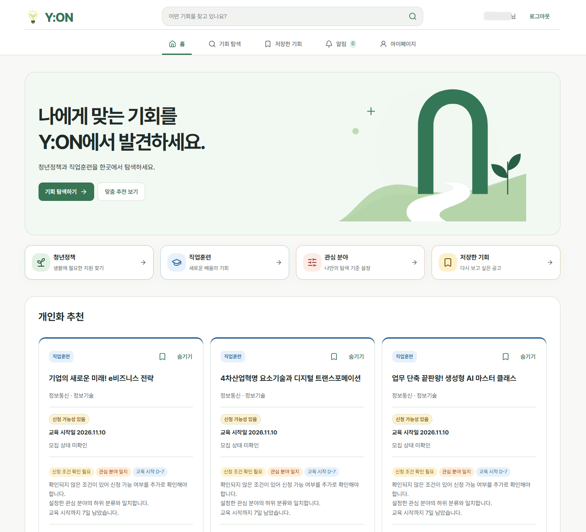
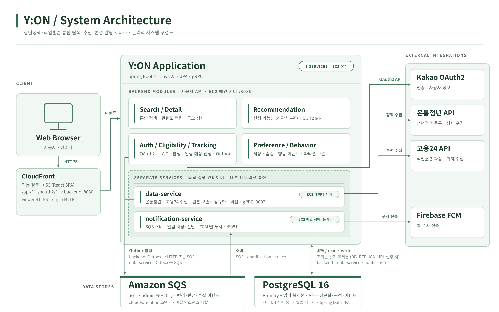
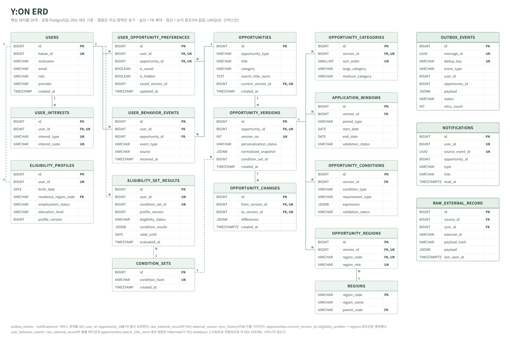

<p>
  
</p>

# Y:ON

> **사용자가 기회를 찾는 것이 아니라, 기회가 사용자를 찾아오게 한다.**

**Y:ON**은 대학생·취업준비생·사회초년생을 위한 **청년정책·직업훈련 통합 탐색 및 맞춤형 변경 추적·알림 서비스**이다.

온통청년과 고용24에 분산된 정보를 수집·정규화하고, 사용자의 프로필과 관심 분야를 기준으로 신청 가능성을 판정해 적합한 기회를 추천한다.   
신규 등록·정보 변경·마감 임박까지 추적해 필요한 지원 기회를 놓치지 않도록 돕는다.

- **서비스:** [Y:ON 바로가기](https://du6sy07fqyo56.cloudfront.net) · [GitHub](https://github.com/prgrms-be-devcourse/NBE11-13-final-Team03)
- **개발 기간:** 2026.10.06 ~ 2026.11.02
- **팀 구성:** 백엔드 중심 4인 팀, 프런트엔드 및 인프라 공동 구현

> 서비스 주소는 배포 진입점이며, 상시 가동 여부는 운영 상태에 따라 달라질 수 있다.

## 서비스 미리보기



## 서비스 시연

| UI 기능 시연 | API 기능 시연 |
|:---:|:---:|
| [](https://youtu.be/FhTisM51ZEc) | [](https://youtu.be/skqdlDxPpMg) |
| 사용자 화면 및 주요 기능 시연 | 백엔드 API 및 주요 처리 흐름 시연 |

---

## 1. 프로젝트 소개

청년 지원 정보는 여러 기관에 분산되어 있고 정책마다 신청 기간·자격조건·분류 체계가 다르다.   
사용자는 각 사이트를 오가며 조건을 확인해야 하며, 등록 이후 변경된 내용이나 마감 일정을 놓치기 쉽다.

Y:ON은 다음 흐름을 하나의 서비스로 연결한다.

1. **통합:** 온통청년 청년정책과 고용24 직업훈련 데이터를 공통 구조로 정리한다.
2. **판정·추천:** 사용자 조건과 관심 분야를 바탕으로 신청 가능성을 판단하고 적합한 기회를 제안한다.
3. **추적·알림:** 신규·변경·마감 임박 정보를 감지해 사용자에게 알린다.

단순한 검색 서비스에 그치지 않고, 외부 데이터의 변경과 사용자 적합성 변화를 지속적으로 다루는 것을 목표로 한다.   
약 4주의 개발 기간을 고려하여 공공데이터 수집·판정·탐색·알림의 핵심 흐름을 우선 연결하고,   
성능과 운영 측면의 문제는 실제 측정과 검증을 바탕으로 개선했다.

## 2. 팀원 및 역할

| 팀원 | 주요 담당 영역 |
| --- | --- |
| 신창선 | 외부 API 연동·수집, 원본 데이터·수집 이력, 스케줄러, 데이터 서비스 및 인프라·테스트 협업 |
| 이정균 | 공고 정규화, 조건 묶음·신청 가능성 판정, 판정 배치, 데이터·인프라 협업 |
| 박예은 | 통합 검색·상세, 관련도 랭킹, 개인화 추천, 저장·숨김·행동 이벤트, React 프런트엔드 |
| 정집협 | 회원·카카오 인증, 공고·사용자 변경 추적, Outbox·알림, 인앱·FCM 웹 푸시 |

> 위 표는 주요 기능 책임을 요약한다. CI/CD·인프라·DB 운영·테스트 등은 여러 팀원이 협업한 영역이다.

## 3. 주요 기능

### 사용자 기능

| 기능 | 설명 |
| --- | --- |
| 통합 검색 | 청년정책·직업훈련 키워드 검색, 지역·유형·분류·모집 상태·날짜·신청 가능성 필터 및 정렬 |
| 상세 조회 | 공통 정보와 정책/훈련 유형별 상세 정보, 신청 기간, 조건별 판정 근거 제공 |
| 개인화 추천 | 신청 가능성·관심 분야·우선 시기를 고려해 최대 5개 기회 추천 및 추천 이유 제공 |
| 저장·숨김 | 관심 공고 저장, 저장 목록 조회, 추천에서 숨김 및 되돌리기 |
| 회원·프로필 | 카카오 로그인, 사용자 조건·관심 분야 관리, 계정·세션 관리 |
| 변경 알림 | 신규·변경·마감 임박 정보에 대한 인앱 알림 및 웹 푸시 |

### 데이터 처리 및 운영 기능

| 기능 | 설명 |
| --- | --- |
| 수집·원본 보존 | 온통청년·고용24 공공 API 및 원문 정보 수집, Raw 스냅샷·동기화 상태 관리 |
| 정규화·버전 관리 | 공고·신청기간·지역·분류·조건을 표준화하고 버전별 변경 이력 관리 |
| 신청 가능성 판정 | 사용자 프로필과 공고 조건을 비교하고 판정 상태 및 근거 저장 |
| 변경 추적·알림 전달 | 변경 이벤트와 사용자 관심·조건 일치 여부를 처리하고 알림 발송 |
| 관리자 | 수집 이력·원본 레코드 조회, 수집 실행·재시도, 행동 이벤트 보관 계획 확인·관리 |

## 4. 기술 스택

| 영역 | 기술 |
| --- | --- |
| Backend | Java 25, Spring Boot 4, Spring MVC, Spring Security |
| Frontend | React, TypeScript, Vite, TanStack Query, Axios |
| Persistence | PostgreSQL 16, Spring Data JPA, Hibernate |
| 인증 | Kakao OAuth2, JWT |
| 메시징·알림 | Transactional Outbox, Amazon SQS, FCM |
| 인프라·배포 | AWS EC2, CloudFront, Docker, Docker Compose, Nginx, Terraform |
| CI·테스트 | GitHub Actions, GHCR, JUnit 5, Testcontainers, k6 |

각 기술의 적용 범위와 환경별 설정은 해당 서비스의 빌드 파일, `infra/`, `deploy/`, `docker/`를 기준으로 확인한다.

## 5. 시스템 아키텍처



전체 구조는 **수집·정규화 → 판정·검색·추천 → 변경 추적·알림**의 처리 흐름을 기준으로 세 서비스로 나누었다.

- **backend:** 인증·프로필·신청 가능성·검색·상세·추천·사용자 행동·관리자 API를 제공한다. 수집 관리자 요청은 내부 gRPC로 data-service에 전달한다.
- **data-service:** 외부 데이터 수집·원본 보존·정규화·버전 관리를 담당한다.
- **notification-service:** 변경 이벤트를 소비해 인앱 알림을 저장하고 FCM 웹 푸시를 전달한다.
- **PostgreSQL:** 읽기 복제본 라우팅은 `DB_REPLICA_URL` 설정 시 활성화되며, 복제본 장애 시 Primary로 대체한다.
- **메시징:** backend 알림 Publisher는 HTTP 또는 SQS를 설정으로 선택하고, data-service는 SQS로 발행한다.
- **배포:** CloudFront가 S3(React)와 backend를 경로별로 분기하고, 서버별 Docker Compose 배포와 Terraform 인프라 구성을 분리한다.

## 6. 데이터 모델



외부 원본과 사용자에게 제공할 표준 공고를 분리하고, 공고 버전에 조건·신청기간·지역·분류를 연결해 변경 추적과 판정 재사용을 지원한다.

- **수집·정규화:** `raw_external_record` → `opportunities` / `opportunity_versions` 및 버전 하위 테이블
- **판정·개인화:** `eligibility_profiles`, `condition_sets`, `eligibility_set_results` — 조건 묶음 단위로 판정을 재사용
- **이용·추적:** `user_opportunity_preferences`, `user_behavior_events`, `opportunity_changes`, `outbox_events`, `notifications`

> 핵심 테이블 18개 기준이며, 전체 스키마는 `database/`와 각 서비스의 JPA 엔티티를 기준으로 한다.

## 7. 핵심 구현

### 7.1 공공데이터 수집과 원본 변경 감지

외부 기관마다 데이터 형식과 제공 주기가 다르므로 수집한 원본 데이터(Raw)와 정규화된 공고 데이터를 분리하여 관리한다.   
출처와 외부 식별자, 원본 스냅샷을 보존하고, 재수집 시 변경 여부를 확인해 정규화 및 버전 관리에 반영한다.   
이를 통해 중복 수집과 실제 공고 변경을 구분하고, 수집 이력·동기화 상태·실패 재시도 과정을 관리한다.

관련 문서: [수집·정규화 서비스 분리](docs/ingest-split.md) · [원본 데이터 파티셔닝](docs/raw-external-record-partitioning.md)

### 7.2 공고 정규화 및 신청 가능성 판정

정책과 훈련 과정의 서로 다른 날짜·분류·자격조건을 공통 모델로 변환하고, 검증 상태와 원문 근거를 보존한다.   
사용자 프로필과 자격조건을 비교해 `ELIGIBLE`, `POSSIBLY_ELIGIBLE`, `NOT_ELIGIBLE`, `UNKNOWN`으로 판정하며,   
버전과 판정 최신성을 고려해 결과를 재사용한다.

다중 분류 정책은 `opportunity_categories`의 대·중분류 관계를 보존해 검색·추천·추적에서 일관되게 비교한다.

관련 PR: [#132 다중 분류 저장](https://github.com/prgrms-be-devcourse/NBE11-13-final-Team03/pull/132) · [#135 분류 명칭 통합](https://github.com/prgrms-be-devcourse/NBE11-13-final-Team03/pull/135)

### 7.3 통합 검색과 관련도 정렬

기존 제목 `LIKE` 검색에서는 띄어쓰기·동의어 차이로 관련 공고가 누락되고, 최신순 정렬만으로는 검색어와의 관련성을 반영하기 어려웠다.   
이에 **검색 후보 확장(B1)** 단계에서 검색어 정규화·토큰·동의어·정책/훈련 특성 필드를 활용해 후보를 넓혔다.   
다음 **관련도 순위 산정(B2)** 단계에서는 제목 완전 일치·접두 일치·구문 일치 등의 단계와 정책 키워드·훈련 분류의 일치 정도를 결합했다.   
지역·모집 상태·신청 가능성 필터와 페이지네이션 계약은 유지했다.

BM25도 동일한 후보 집합에서 비교했다.   
일부 넓은 검색어에서는 BM25가 동점 후보의 순위를 더 세밀하게 나눴지만,   
사람 평가 데이터가 5개 검색어에 한정되어 품질 우위를 일반화하기 어려웠다.   
또한 토큰화·통계 갱신·데이터 동기화 비용이 추가된다.   
따라서 프로젝트 규모와 일정에 맞춰, 규칙이 명확하고 운영 부담을 관리하기 쉬운 방식의 랭킹을 유지했다.

관련 PR: [#112 통합 검색 후보·랭킹 개선](https://github.com/prgrms-be-devcourse/NBE11-13-final-Team03/pull/112)

### 7.4 개인화 추천과 후보 선정 최적화

사용자 신청 가능성과 관심 분야를 우선순위 그룹으로 분류하고, 마감·개강 시기 등을 반영해 최대 5건을 추천한다.   
기존의 Java 전체 후보 순회는 DB·JDBC 비용이 컸으므로 PostgreSQL에서 그룹별 상위 후보를 먼저 선정하도록 변경했다.   
Java의 최종 혼합·추천 사유 로직은 유지하며 기존 구현과 결과 동등성을 검증했다.

관련 PR: [#116 추천 구조 개선](https://github.com/prgrms-be-devcourse/NBE11-13-final-Team03/pull/116)

### 7.5 변경 추적과 안정적인 알림 전달

공고의 새로운 버전과 사용자 조건·관심 분야 변화를 추적해 대상 사용자에게 알림을 제공한다.   
Outbox·메시징을 활용해 비즈니스 상태 변경과 알림 전달 단계를 분리하고, 인앱 알림·FCM 웹 푸시로 결과를 전달한다.

관련 문서: [Outbox 이벤트 전파](docs/event-fanout-outbox.md) · [알림 전달](docs/notification-delivery.md) · [SQS 연동](docs/notification-sqs.md)

### 7.6 사용자 행동 데이터와 보관 정책

추천 노출·상세 진입·외부 링크 클릭·저장·숨김을 기록한다.   
저장·숨김은 실제 상태 전환에만 이벤트를 기록하고 이벤트 처리 실패가 핵심 요청을 실패시키지 않도록 트랜잭션을 분리한다.   
이벤트 누적에 대응해 월별 파티셔닝과 최근 4개월 보관 정책, 관리자 미리보기·실행 API를 마련했다.

관련 PR: [#130 행동 이벤트 수집·보관](https://github.com/prgrms-be-devcourse/NBE11-13-final-Team03/pull/130)

## 8. 성능 및 안정성 검증

### 주요 개선 결과

| 영역 | 문제 및 개선 | 측정 결과 |
| --- | --- | --- |
| 추천 | 약 10만 건 후보 전체 순회 → DB에서 그룹별 상위 후보 선정 | 관심 미설정 사용자 평균 **12,401→1,033ms(12.0배)**, 대중적 관심 **10,891→721ms(15.1배)**, 드문 관심 **9,830→568ms(17.3배)**; 관심 미설정 SQL **4,933→11회** |
| 검색 | 복합 필터 SQL 및 JIT 컴파일 비용 분석 → 검색 트랜잭션 JIT OFF 등 | 정책+지역+마감일 정렬 시 중앙값 **5,647→406ms** |
| 상세 | 판정 결과 조회 시 중복 데이터 접근 제거 | SQL **3회 감소**, 평균 응답 약 **30% 단축** |
| 행동 이벤트 | 데이터 적재·보관 정책 검증 | INSERT 평균 DB 실행 **0.40~0.57ms**, 추가 최적화 대신 정합성 유지 |

> **측정 범위:** 표의 결과는 PR에 기록된 독립 PostgreSQL 또는 MockMvc 기반 실험 환경에서 측정한 값이다. 운영 환경 처리량이나 SLA로 해석하지 않는다. 검색·추천의 측정 시나리오와 시점은 서로 다르다.

- [#102 검색 SQL·JIT 개선](https://github.com/prgrms-be-devcourse/NBE11-13-final-Team03/pull/102)
- [#115 상세 조회 중복 SQL 개선](https://github.com/prgrms-be-devcourse/NBE11-13-final-Team03/pull/115)
- [#116 개인화 추천 구조 개선](https://github.com/prgrms-be-devcourse/NBE11-13-final-Team03/pull/116)

### 테스트·운영 안정성

- **통합 검증:** JUnit 5와 Testcontainers로 PostgreSQL의 실제 쿼리·트랜잭션·분류 매칭을 검증한다.
- **회귀 검증:** 검색·추천 변경 전후 결과의 동일성, UI/API 연동 및 필수 테스트 실행 정책을 검증한다.
- **읽기 부하 분리:** 검색·상세·추천 조회의 PostgreSQL 복제본 라우팅과 장애 시 Primary 대체 경로를 지원한다.
- **백업·복원:** 데이터베이스 백업과 복원 검증 절차를 마련한다.
- **부하 테스트:** k6와 EC2 t3.small 자원 제한을 모사한 Docker 측정 환경(`perf/`)을 구성했다. 반복 측정 실행과 p95·에러율 확보는 후속 과제다.

관련 PR: [#93 읽기 복제본 라우팅](https://github.com/prgrms-be-devcourse/NBE11-13-final-Team03/pull/93) · [#137 k6 측정 환경](https://github.com/prgrms-be-devcourse/NBE11-13-final-Team03/pull/137)

## 9. 프로젝트 결과 및 한계

### 주요 결과

- 청년정책·직업훈련의 수집, 정규화, 신청 가능성 판정, 검색·추천, 변경 추적·알림을 하나의 사용자 흐름으로 연결했다.
- 원본·표준 모델·버전·조건을 분리해 외부 데이터 변경과 사용자별 판단을 관리했다.
- 검색·추천의 정확성과 응답 지연을 측정하고 개선했으며 결과 동등성 회귀 테스트를 수행했다.
- PostgreSQL 읽기 복제본, 백업·복원, 인프라 코드화, CI 검증과 관리 기능으로 운영 기반을 확장했다.

### 남은 한계 및 개선 방향

- 검색·추천의 **운영 환경 p95/p99 및 동시 접속 한계**를 부하 테스트와 모니터링으로 추가 확인할 필요가 있다.
- 추천 쿼리의 실행 계획 변동과 후보 증가에 따른 비용을 지속적으로 관찰해야 한다.
- 행동 이벤트는 현재 수집·보관 중심이며, **행동 기반 추천 학습/점수화는 구현 범위가 아니다.**
- 배포 전후 데이터 정리 SQL, 파티션 보관 정책, 운영 스모크 테스트 등은 코드 구현과 운영 적용 상태를 구분해 점검해야 한다.

## 10. 프로젝트 구조

```text
NBE11-13-final-Team03/
├── backend/                # 사용자 API, 판정, 검색·추천, 인증·관리자 API
├── data-service/           # 공공 API 수집, Raw 관리, 정규화
├── notification-service/   # 알림 소비·저장, 인앱 알림, 웹 푸시
├── frontend/               # React 사용자·관리자 화면
├── database/               # 데이터베이스 DDL·운영 SQL·마이그레이션
├── contracts/              # 서비스 간 공용 계약
├── docker/                 # 로컬 전체 실행 환경
├── deploy/                 # 서버별 배포 및 운영 스크립트
├── infra/                  # Terraform 인프라 구성
├── perf/                   # 성능·부하 테스트 도구
├── docs/                   # 설계·운영 문서
└── .github/                # CI 워크플로
```

## 11. 로컬 실행

**필수 도구:** Java 25, Docker (Testcontainers 기반 테스트 실행 시 Docker가 켜져 있어야 함)

### 전체 실행

1. `docker/.env.example`을 `docker/.env`로 복사하고 필요한 환경변수를 설정한다.
2. 저장소 루트에서 아래 명령을 실행한다.

```bash
./docker/start.sh
```

실행 구성은 PostgreSQL, data-service, backend, notification-service, nginx이다. 로컬 브라우저 진입점은 `http://localhost`이다.

### 개발용 DB만 실행

```bash
cd docker
docker compose up -d postgres-db
```

서버를 IDE 또는 `bootRun`으로 실행하는 경우   
`backend/.env.example`, `notification-service/.env.example`을 바탕으로 각각 환경변수를 설정한다.   
`bootRun`은 각 프로젝트의 `.env`를 읽지만 `java -jar`는 해당 파일을 자동으로 읽지 않는다.

### 종료

```bash
cd docker
docker compose down
```

> `docker compose down -v`는 로컬 DB 볼륨을 삭제하므로 데이터 초기화 의도가 있을 때만 사용한다.

자세한 설정·포트·주의 사항: [docker/README.md](docker/README.md)

## 12. Git Convention

### Branch Strategy

`main` 중심의 기능 브랜치 전략을 사용한다.

| 브랜치 | 용도 |
| --- | --- |
| `main` | 통합 기준 브랜치 |
| `feat/*` | 기능 개발 |
| `fix/*` | 오류 수정 |
| `docs/*` | 문서 작성·수정 |
| `refactor/*` | 코드 구조 개선 |

각 브랜치에서 구현·테스트한 뒤 Pull Request 리뷰를 거쳐 `main`에 병합한다. `develop` 브랜치는 현재 사용하지 않는다.

### Commit Convention

커밋 형식은 **`Type: 작업 내용`**이며, 유형의 첫 글자는 대문자로 작성한다.

| 유형 | 의미 |
| --- | --- |
| `Feat` | 기능 추가 |
| `Fix` | 버그 수정 |
| `Docs` | 문서 변경 |
| `Style` / `Design` | 포맷·UI 디자인 변경 |
| `Refactor` | 구조 개선 |
| `Test` | 테스트 추가·개선 |
| `Chore` | 설정 및 기타 관리 |
| `Comment` / `Rename` / `Remove` | 주석·이름 변경·삭제 |
| `!BREAKING CHANGE` / `!HOTFIX` | 호환성 변경·긴급 수정 표시 |

```text
Feat: 온통청년·고용24 API Client 및 수집 Service 추가
Fix: 수집 설정 오류 수정
Refactor: 신청 가능성 판정 로직 개선
Test: 정책 엔진 통합 테스트 추가
Docs: README 프로젝트 소개 및 협업 규칙 추가
```

### Pull Request Convention

- 기능 단위로 Pull Request를 생성하고 목적·변경 사항·테스트 결과를 기재한다.
- 미완료 작업과 확인이 필요한 사항을 명시한다.
- 코드 리뷰 및 수정 사항 반영 후 `main`에 병합한다.
