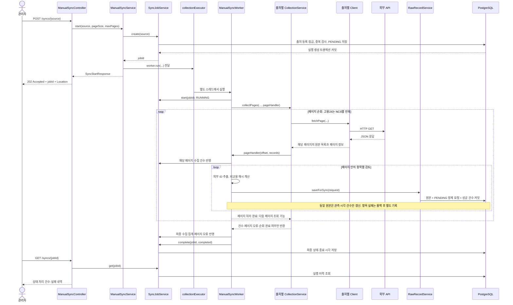
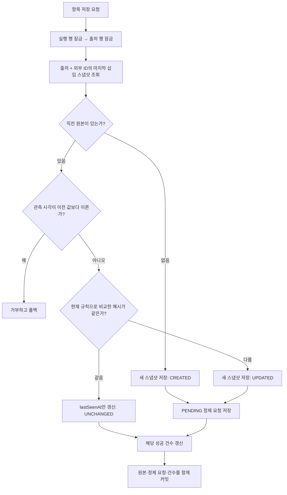

# 수집 파트의 시스템 흐름과 코드 구조

기준: 2026-10-16, `96d1ab4` 이후의 페이지별 처리·정제 요청 등록 변경을 포함한 현재 작업 트리. 이 문서는 현재 동작을 설명하며, 향후 설계 제안을 구현된 기능으로 포함하지 않는다.

## 1. 수집 파트가 하는 일

관리자가 수동 최신화 API를 호출하면 `CollectionService.collectPages()`가 외부 API의 페이지를 순차 조회한다. 각 페이지를 받은 즉시 항목을 직전 원본과 비교해 신규·수정·동일로 나누고, 원본 스냅샷·정제 요청·성공 건수를 PostgreSQL에 함께 커밋한 뒤 다음 페이지로 넘어간다. 전체 실행은 기존처럼 백그라운드에서 동작한다.

현재 수동 최신화는 기존 데이터를 삭제하는 초기화가 아니다. 처음 실행하면 최초 원본과 PENDING 정제 요청이 쌓이고, 이후에는 같은 흐름으로 변경 내용을 추적한다. 정제로 보낸다는 의미는 DB polling용 요청 등록이다. 정제 워커·정규화 실행, 자격 판정, `OpportunityVersion` 생성, 사용자 알림은 구현하지 않았다.

핵심 동작과 실행을 지원하는 기능은 다음처럼 구분할 수 있다.

| 구분 | 현재 구현 |
| --- | --- |
| 수집·저장 핵심 | 외부 API 호출, 페이지별 즉시 처리, 외부 ID 추출, 원본 비교, 스냅샷·정제 요청 저장 |
| 비동기 API 지원 | 실행 ID 발급, 별도 스레드 실행, 상태 조회, 중복 실행 방지 |
| 운영 지원 | 상세 처리 건수, 페이지·항목 오류 보관, 재시작 시 중단 상태 정리 |

## 2. 시스템 플로우

### 2.1 수동 요청부터 저장까지



응답 반환과 백그라운드 실행은 동시에 진행될 수 있다. 시작 응답은 접수 당시의 `PENDING`을 담지만, 클라이언트가 상태를 조회할 때는 이미 `RUNNING` 또는 종료 상태일 수 있다. `202`는 수집 완료를 의미하지 않는다.

### 2.2 호출할 API

```http
POST /api/admin/collection/syncs/YOUTH_POLICY?pageSize=100&maxPages=1000
POST /api/admin/collection/syncs/EMPLOYMENT24?pageSize=100&maxPages=1000
GET  /api/admin/collection/syncs/{jobId}
```

두 출처는 각각 요청한다. 한 번의 요청으로 두 출처를 모두 수집하는 엔드포인트는 없다. 관리자 권한과 기존 CSRF 보호가 적용된다. 상세 요청·응답 계약은 [수동 최신화 API](manual-sync-api.md)를 참고한다.

별도로 `POST /api/admin/collection/raw-records`는 요청에 담긴 원본 하나를 저장하는 API다. 이 API는 `CollectionService`나 외부 API를 호출하지 않는다.

## 3. 클래스를 어떤 역할로 나눴는가

```text
collection/
├─ controller/
│  ├─ ManualSyncController         시작·상태 조회 HTTP 처리
│  └─ RawRecordController          원본 단건 저장·조회 HTTP 처리
├─ client/
│  ├─ YouthPolicyClient           온통청년 한 페이지 호출·검증
│  └─ Employment24Client          고용24 한 페이지 호출·검증
├─ service/
│  ├─ ManualSyncService           입력 범위 검증, 실행 접수, 실행기 전달
│  ├─ ManualSyncWorker            수집 → 항목 저장 → 최종 상태 연결
│  ├─ SyncJobService              실행 이력의 짧은 DB 트랜잭션
│  ├─ YouthPolicyCollectionService  온통청년 페이지 순회
│  ├─ Employment24CollectionService 고용24 NCS·페이지 순회와 재시도
│  ├─ RawRecordFingerprint        외부 ID와 비교용 해시 생성
│  └─ RawRecordService            항목별 잠금·비교·원본 및 정제 요청 저장
├─ domain/
│  ├─ entity/                    ExternalSource, SyncHistory, RawExternalRecord, RawNormalizationRequest
│  ├─ repository/                위 엔티티의 JPA 저장소
│  └─ *.java                     출처·실행 상태·처리 결과 enum
├─ dto/                          요청, 응답, 외부 페이지·수집 결과
└─ exception/                    외부 호출 예외와 CollectionExceptionHandler

config/
├─ CollectionExecutorConfig      수집 전용 스레드 풀
└─ MethodSecurityConfig          메서드 권한 검사 활성화
```

| 경계 | 분리한 이유 |
| --- | --- |
| Controller와 Service | HTTP 응답 형식과 수집·저장 로직을 분리한다. |
| Client와 CollectionService | 한 페이지의 통신·응답 검증과 여러 페이지의 순회·실패 처리는 책임이 다르다. |
| CollectionService와 Worker | 순회·재시도 규칙을 유지하고 페이지 처리기를 전달한다. CollectionService는 처리기가 반환한 뒤 다음 페이지로 진행하며, DB 저장 코드는 Worker와 RawRecordService에 둔다. 기존 `collect()`는 전체 목록 반환이 필요한 호출자를 위한 호환 경로다. |
| Worker와 SyncJobService | 외부 호출을 포함하는 긴 실행과 실행 이력을 변경하는 짧은 트랜잭션을 분리한다. |
| Worker와 RawRecordService | 항목 하나가 실패해도 다른 항목의 커밋을 유지하고 다음 항목을 처리한다. |
| Fingerprint와 저장 서비스 | 외부 식별·비교 표현을 만드는 규칙을 DB 잠금·저장 절차와 구분한다. |
| Entity와 DTO | DB 연관관계를 HTTP로 그대로 노출하지 않고 필요한 필드로 변환한다. |

위 표는 현재 분리의 목적이다. 수집 알고리즘 자체에 모든 서비스 계층이 필수라는 의미는 아니다. 비동기 실행 관리와 상세 운영 기록까지 포함하면서 실행 지원 코드가 추가된 구조다.

## 4. 적용한 알고리즘과 기술

| 기술 | 적용 위치·목적 |
| --- | --- |
| Spring MVC | 관리자 요청을 Controller와 DTO로 받고 HTTP 상태·응답을 반환한다. |
| ThreadPoolTaskExecutor | 요청 스레드와 수집 작업 스레드를 분리한다. |
| RestClient + JDK HttpClient | 외부 HTTP 호출, 연결·읽기 타임아웃, 리다이렉트 금지를 설정한다. |
| Jackson 3 JsonNode | 고정된 정책 DTO로 잘라내지 않고 원본 항목 구조를 유지한다. |
| Spring Data JPA + Hibernate | 저장소 조회, 엔티티 변경 감지, 트랜잭션·비관적 잠금을 사용한다. |
| PostgreSQL JSONB·유일성 제약·인덱스 | 원본 JSON 저장, 출처 중복 방지, 최신 원본·활성 실행 조회를 지원한다. |
| Spring Security | 관리자 메서드 권한 검사와 기존 인증·CSRF 보호를 적용한다. |

### 4.1 Spring 실행기로 비동기 실행

`ManualSyncService`는 실행 생성 트랜잭션이 커밋된 후 `TaskExecutor.execute()`로 작업을 전달한다. 실행 이력을 만들기도 전에 작업 스레드가 DB를 조회하는 순서 문제를 방지한다.

`CollectionExecutorConfig`는 `ThreadPoolTaskExecutor`를 코어 2개·최대 2개·대기 큐 0개로 구성한다. 같은 출처는 중복 실행을 막으므로 두 출처를 각각 한 작업씩 처리할 수 있다. 대기 큐를 쌓아 두는 작업 시스템은 구현하지 않았다.

실행기가 작업을 거절하면 이미 만든 실행 이력을 `FAILED`로 마감하고 시작 요청에 `503`을 반환한다. `@Async`는 사용하지 않으며, 명시적으로 실행기에 작업을 전달한다.

### 4.2 페이지 순회와 제한된 재시도

| 규칙 | 온통청년 | 고용24 |
| --- | --- | --- |
| 순회 단위 | 페이지 1부터 순차 조회 | NCS 01~24 각각 페이지 1부터 조회 |
| 조회 기간 | 현재 구현에서 별도 기간 조건 없음 | 실행 시 계산한 한국 날짜 기준 오늘~6개월 후, 훈련 시작일 범위 |
| 정상 종료 | 빈 목록 또는 전체 건수 범위 도달 | NCS별 빈 목록 또는 전체 건수 범위 도달 |
| 페이지 상한 | 전체 순회에 `maxPages` 적용 | 각 NCS에 `maxPages` 적용 |
| 동일 페이지 재시도 | 없음 | 재시도 가능한 오류에 최초 요청 포함 최대 3회 |
| 일반 페이지 실패 | 실패를 기록하고 다음 페이지 진행 | 첫 페이지 실패는 해당 NCS 중단, 중간 페이지 실패는 다음 페이지 진행 |
| HTTP 401·403 | 전체 순회 중단 | 전체 순회 중단, 현재·남은 NCS 미완료 기록 |

고용24 재시도는 즉시 반복한다. 지수 백오프, 대기 시간, `Retry-After` 처리는 현재 없다. 온통청년 예외의 `retryable` 값은 기록용 정보이며 실제 재시도를 수행하는 것은 아니다.

Client는 HTTP 오류, 연결 오류, 응답 형식 오류를 출처별 예외로 변환한다. HTTP 429·5xx와 연결 오류는 재시도 가능으로 분류하고, 페이지 번호·크기·목록 형식을 검증한다. 기본 연결 타임아웃은 5초, 읽기 타임아웃은 20초이며 리다이렉트는 따르지 않는다.

수동 최신화는 `BiConsumer<Integer, List<JsonNode>>` 페이지 처리기를 전달한다. 첫 인자는 전체 수집 결과에서 해당 페이지의 시작 인덱스이고, 둘째 인자는 현재 페이지의 원본이다. 처리기는 같은 백그라운드 스레드에서 동기적으로 실행되므로 검토·저장·정제 요청 등록이 끝나기 전에 다음 페이지를 조회하지 않는다. 종료 결과인 `CollectionSummary`에는 원본 전체 목록을 담지 않는다. 처리기 예외는 HTTP 조회의 try/catch 밖에서 전파되므로 DB 처리 실패를 외부 API 재시도로 오인하지 않는다.

온통청년은 HTTP 상태와 JSON의 `resultCode`도 따로 확인한다. JSON의 실패 코드는 `API_ERROR`로 표현하며, HTTP 401·403 중단 분기와 동일한 분기가 아니다.

`completed`는 페이지 순회 완료 여부다. 중간 페이지 실패가 있어도 마지막까지 진행했다면 true일 수 있다. 최종 성공 여부는 실패 목록까지 함께 판단한다.

### 4.3 외부 ID 추출

| 출처 | 식별 방법 | 이유 |
| --- | --- | --- |
| 온통청년 | 문자열 `plcyNo` | 제목 대신 외부 시스템 식별자를 유지한다. |
| 고용24 | 문자열 `trprId`, `trprDegr`를 JSON 배열 문자열로 결합 | 같은 과정의 다른 회차를 분리하고 단순 구분자 결합의 충돌을 피한다. |

예를 들어 고용24의 외부 ID는 `["course-1","01"]`이다. `01`을 임의로 `1`로 바꾸지 않는다. 필드가 없거나 문자열이 아니거나 최종 식별자가 255자를 넘으면 해당 항목을 실패로 기록한다.

### 4.4 재귀적 키 정렬과 SHA-256 비교

`RawRecordFingerprint.hash()`의 처리 순서는 다음과 같다.

```text
원본 JsonNode
  → 객체 키를 TreeMap으로 정렬한 별도 JSON 생성
  → 중첩 객체도 재귀적으로 정렬
  → 배열의 원소 순서는 유지
  → JSON 문자열을 UTF-8 바이트로 변환
  → SHA-256
  → "sha256-json-v1:" + 64자리 16진수
```

객체 키의 순서만 바뀌었을 때 불필요한 변경을 만들지 않기 위한 비교 표현이다. 숫자와 문자열, null과 빈 문자열, 배열 순서는 임의로 같게 만들지 않는다. 정책 문구를 해석하거나 자격 조건을 정규화하는 과정은 아니다.

정렬할 객체의 키 수를 k라고 하면 해당 객체의 키 정렬은 O(k log k), 직렬화와 해시는 생성한 JSON 크기에 비례한다. 비교용 JSON을 별도로 만들기 때문에 그만큼의 임시 메모리도 사용한다.

### 4.5 직전 스냅샷과 비교해 멱등 저장



위 그림은 수동 최신화가 호출하는 `saveForSync()` 기준이다. 최근 원본은 `source_id + external_id`로 조회하고 `id DESC`의 첫 행을 선택한다. 즉, 마지막으로 삽입한 스냅샷이 비교 대상이다.

수동 최신화는 직전 payload도 현재 해시 규칙으로 다시 계산한다. 과거에 저장된 해시 문자열의 규칙이 다르다는 이유만으로 수정으로 분류하지 않기 위해서다. 단건 저장 API의 `save()`는 요청 해시와 기존 저장 해시를 직접 비교한다.

| 관측 순서 | 저장 결과 |
| --- | --- |
| 첫 A | 스냅샷 A 생성 |
| A → A | 추가 스냅샷 없이 마지막 관측 시각 갱신 |
| A → B | 스냅샷 B 추가 |
| A → B → A | 마지막 B와 비교해 새 A 추가: 총 3개 |

모든 과거 해시에서 A를 찾고 중복으로 생략하는 방식은 사용하지 않는다. 같은 출처·외부 ID로 여러 변경 스냅샷이 필요하므로 이 두 컬럼만으로 유일성 제약을 걸지도 않는다.

### 4.6 JPA 트랜잭션과 비관적 잠금

출처 최초 등록에는 PostgreSQL `INSERT ... ON CONFLICT DO NOTHING`을 사용한다. 동시에 최초 요청이 들어와도 `source_code`의 유일성 제약으로 출처 중복을 방지하며, 기존 출처의 enabled 값이나 메타데이터는 덮어쓰지 않는다.

실행 접수는 출처 행을 `PESSIMISTIC_WRITE`로 잠근 후 PENDING/RUNNING 실행이 있는지 검사한다. 검사와 실행 생성이 같은 트랜잭션이므로 동일 출처의 두 접수 요청이 동시에 통과하지 않도록 한다.

원본 저장은 수집 실행 행, 출처 행 순서로 잠근다. 같은 외부 ID가 아직 없는 최초 삽입도 출처 행을 공통 잠금 대상으로 사용해 직렬화한다. 출처 단위 잠금은 구현이 단순하지만 같은 출처의 다른 항목도 병렬 저장하지 못한다. 병목이 확인될 때 외부 키별 현재 상태 행을 두는 방식으로 바꿀 수 있다.

| 트랜잭션 | 포함하는 작업 |
| --- | --- |
| 실행 생성 | 출처 등록·잠금, 활성 실행 확인, PENDING 생성 |
| 실행 시작 | PENDING → RUNNING |
| 수집 결과 반영 | 수집 항목 수·페이지 실패·미완료 NCS 저장 |
| 페이지 수신 | 현재 페이지의 항목 수를 fetchedCount에 추가 |
| 항목 저장 | 실행·출처 잠금, 직전 원본 비교, 신규·수정이면 원본·PENDING 정제 요청 저장, 동일이면 관측 시각 갱신, 성공 건수 갱신 |
| 항목 실패 기록 | 앞선 항목 트랜잭션 롤백 후 오류·실패 건수 저장 |
| 실행 종료 | 최종 상태와 종료 시각 저장 |

Worker 전체에는 `@Transactional`을 붙이지 않았다. 외부 HTTP 대기나 전체 순회를 하나의 긴 DB 트랜잭션으로 묶지 않기 위해서다. Worker가 별도 Spring Bean의 공개 트랜잭션 메서드를 호출하므로 같은 객체 내부 호출에 따른 프록시 우회도 피한다.

### 4.7 PostgreSQL JSONB와 Jackson 3

외부 응답의 각 항목은 `JsonNode`로 유지하고, `@JdbcTypeCode(SqlTypes.JSON)`으로 JSONB에 저장한다. 알려진 필드만 DTO로 추려 저장하지 않으므로 외부 API가 추가한 필드와 중첩 구조도 보존한다.

이 프로젝트는 `tools.jackson`의 Jackson 3을 사용한다. Hibernate에도 `Jackson3JsonFormatMapper`를 지정해 저장 후 조회 시 같은 타입을 복원하도록 했다.

보존 대상은 파싱된 항목의 JSON 값이다. 전체 HTTP 응답 본문, 헤더, 공백, 원래 키 순서, 중복 키까지 바이트 단위로 보관하는 구조는 아니다.

## 5. DB에 무엇이 남는가

| 엔티티 | 역할 | 핵심 정보 |
| --- | --- | --- |
| `ExternalSource` | 출처 식별·활성 여부 | sourceCode, sourceName, baseUrl, enabled |
| `SyncHistory` | 수집 실행 한 번의 상태와 처리 결과 | 출처, 상태, 건수, 실패 목록, 접수·종료 시각 |
| `RawExternalRecord` | 변경 시점의 원본 스냅샷 | 출처·생성 실행, externalId, payloadHash, payload, 최초·마지막 관측 시각 |
| `RawNormalizationRequest` | DB polling으로 전달할 정제 요청 | 원본 스냅샷 ID(UNIQUE), 직전 스냅샷 ID, CREATED/UPDATED, PENDING, 생성 시각 |

정제 요청은 신규·수정 스냅샷당 하나만 등록한다. INSERT 실패 시 원본과 성공 건수도 롤백한다. 동일 원본의 추가 요청과 기존 스냅샷의 소급 요청은 만들지 않는다. DB polling 워커의 요청 선점·정제 처리는 이 수집 구현의 범위에 포함하지 않는다.

`RawExternalRecord.sync_id`는 그 스냅샷을 생성한 실행이다. 다음 실행에서 같은 원본을 확인해도 이 연결을 새 실행으로 바꾸지 않는다.

`firstSeenAt`은 해당 스냅샷의 최초 관측 시각이며, 정책 전체 생애의 최초 수집 시각을 별도로 나타내는 필드는 아니다. Worker는 항목 저장 요청을 만들 때의 현재 시각을 `collectedAt`으로 전달하므로 외부 API 응답이 도착한 정확한 시각과도 구분해야 한다.

실행 건수의 정의는 다음과 같다.

```text
fetchedCount      = CollectionService가 반환한 항목 수: 중복 포함
successCount      = newCount + updatedCount + unchangedCount
changed_count(DB) = newCount + updatedCount
failedRecordCount = 항목 처리 실패 수
failedPageCount   = 두 출처의 실패 페이지 목록 길이 합
pendingCount      = max(0, fetchedCount - successCount - failedRecordCount)
```

## 6. 상태·예외·재시작 처리

| 상태 | 의미 |
| --- | --- |
| PENDING | 실행 이력이 생성되고 실행기에 전달될 단계 |
| RUNNING | Worker가 실행을 시작한 상태 |
| SUCCESS | 순회 완료, 페이지·항목 실패 없음, 미처리 없음. 정상 빈 목록도 포함 |
| PARTIAL_SUCCESS | 최종 집계에서 일부 항목을 성공 처리했지만 실패·미완료가 남음 |
| FAILED | 정상 항목 없이 수집이 실패했거나 실행 자체의 예상 밖 오류·실행기 거절 발생 |
| INTERRUPTED | 중단 감지 또는 단일 서버 재시작 복구로 실행 마감 |

항목의 잘못된 식별자·요청 값은 `INVALID_RECORD`, DB 저장 예외는 `STORAGE_FAILED`로 기록하고 다음 항목을 진행한다. 그 밖의 실행 전체 오류는 Worker의 바깥 예외 처리에서 FAILED로 마감한다. 이미 성공한 원본이 있어도 이 실행 전체 오류 경로에서는 FAILED가 될 수 있다.

`CollectionExceptionHandler`는 `collection.exception`에 있으며, 두 컨트롤러에 한정해 요청 오류·대상 없음·상태 충돌·저장소 오류·실행기 거절을 HTTP 응답으로 바꾼다. 비동기로 접수된 이후의 실패는 원래 HTTP 응답을 변경할 수 없으므로 상태 조회로 확인한다.

서버 시작 시 이전 프로세스에서 접수한 MANUAL 실행 중 PENDING/RUNNING 상태를 INTERRUPTED로 마감한다. 이미 커밋한 원본과 건수는 유지하지만 자동 재실행은 하지 않는다. 현재 복구는 단일 앱 인스턴스 전제이며 다중 서버의 소유권·임대 복구는 구현하지 않았다.

## 7. 코드의 기본 골자

아래는 실제 코드의 핵심 순서를 압축한 의사코드다. 복사해 컴파일하는 완전한 구현은 아니며, 상세 예외 처리·DTO 생성·출처 분기는 생략했다.

### 7.1 접수와 비동기 실행

```java
// ManualSyncService: 전체 메서드는 DB 트랜잭션으로 묶지 않는다.
validateLimits(pageSize, maxPages);
SyncStartResponse accepted = jobs.create(source); // 별도 트랜잭션이 반환 전에 커밋
executor.execute(() -> worker.run(accepted.jobId(), source, pageSize, maxPages));
return accepted; // Controller가 202 + Location으로 반환
```

### 7.2 전체 작업 연결

```java
// ManualSyncWorker
jobs.start(jobId);
var summary = collectionService.collectPages(..., (offset, page) -> {
    jobs.recordFetchedPage(jobId, page.size());
    for (JsonNode payload : page) {
        String externalId = fingerprint.externalId(source, payload);
        String hash = fingerprint.hash(payload);
        rawRecords.saveForSync(new RawRecordSaveRequest(
                jobId, externalId, hash, payload, OffsetDateTime.now()));
        // 항목 실패는 롤백 이후 jobs.recordFailure(...)로 기록하고 계속 진행
    }
}); // 페이지 처리기가 반환한 뒤 다음 페이지를 조회한다.
jobs.recordCollection(jobId, summary.fetchedCount(), ...);
jobs.complete(jobId, summary.completed());
```

### 7.3 원본 하나의 트랜잭션

```java
// RawRecordService.saveForSync: 하나의 @Transactional 범위
var sync = lockSyncHistory(jobId);
requireRunning(sync);
lockSource(sync.getSource().getId());
var previous = findLatestBySourceAndExternalId(...);
rejectOlderObservation(previous, collectedAt);

if (previous == null) {
    var raw = insertSnapshot(...);
    insertPendingNormalizationRequest(raw, null, CREATED);
    sync.recordSuccess(CREATED);
} else if (fingerprint.hash(previous.getPayload()).equals(hash)) {
    previous.markSeenAt(collectedAt);
    sync.recordSuccess(UNCHANGED);
} else {
    var raw = insertSnapshot(...);
    insertPendingNormalizationRequest(raw, previous, UPDATED);
    sync.recordSuccess(UPDATED);
}
// 원본·정제 요청·건수가 함께 커밋되거나 함께 롤백된다.
```

## 8. 현재 구현의 범위와 제약

1. **수동 최신화는 페이지 단위로 처리한다.** 현재 페이지를 처리하고 나면 다음 페이지로 넘어가며 원본 전체를 누적하지 않는다. 기존 `collect()`를 직접 호출하면 호환성을 위해 전체 목록을 모아 반환한다. 오류 목록과 실행 건수는 별도로 유지한다.
2. **페이지 API는 고정 스냅샷이 아니다.** 수집 중 목록이 바뀌면 페이지 경계에서 중복·누락이 생길 수 있다. SUCCESS가 외부 데이터의 완전한 동시점 복제를 보장하지 않는다.
3. **외부 데이터의 실제 최신성을 증명하지 않는다.** 같은 출처의 수동 실행 중첩과 이전 관측 시각은 검사하지만 신뢰 가능한 외부 revision을 검증하는 로직은 없다.
4. **원본 변경과 정책 변경은 다르다.** 원본 문자열이나 부가 정보가 바뀌었다고 자격 조건·마감일 변경이나 알림을 확정하지 않는다.
5. **전달·관측 이력에는 범위가 있다.** 신규·수정 원본의 정제 요청은 등록하지만, 성공 항목마다 별도 관측 행을 남기거나 실패 payload 전체를 보존하지 않는다. 기존 원본의 요청을 소급 등록하는 백필과 정제 워커는 별도 구현이 필요하다. 실패 재시도는 현재 출처 전체 재실행 방식이다.
6. **이전 프로세스의 작업을 자동 재개하지 않는다.** DB의 미완료 실행을 중단 상태로 정리하고 관리자가 다시 실행하도록 한다. 다중 서버 복구나 자동 재개는 지원하지 않는다.

## 9. 코드와 검증 자료

| 확인할 내용 | 위치 |
| --- | --- |
| 수동 HTTP 진입점 | [ManualSyncController](../backend/src/main/java/com/team3/backend/collection/controller/ManualSyncController.java) |
| 비동기 작업 전달 | [ManualSyncService](../backend/src/main/java/com/team3/backend/collection/service/ManualSyncService.java) |
| 실행 전체 순서 | [ManualSyncWorker](../backend/src/main/java/com/team3/backend/collection/service/ManualSyncWorker.java) |
| 실행 이력 트랜잭션·복구 | [SyncJobService](../backend/src/main/java/com/team3/backend/collection/service/SyncJobService.java) |
| 온통청년 순회 | [YouthPolicyCollectionService](../backend/src/main/java/com/team3/backend/collection/service/YouthPolicyCollectionService.java) |
| 고용24 순회·재시도 | [Employment24CollectionService](../backend/src/main/java/com/team3/backend/collection/service/Employment24CollectionService.java) |
| 식별·해시 | [RawRecordFingerprint](../backend/src/main/java/com/team3/backend/collection/service/RawRecordFingerprint.java) |
| 원본 비교·저장 | [RawRecordService](../backend/src/main/java/com/team3/backend/collection/service/RawRecordService.java) |
| 실제 엔티티 | [domain/entity](../backend/src/main/java/com/team3/backend/collection/domain/entity) |
| 실제 저장소 | [domain/repository](../backend/src/main/java/com/team3/backend/collection/domain/repository) |
| 비동기 실행 설정 | [CollectionExecutorConfig](../backend/src/main/java/com/team3/backend/config/CollectionExecutorConfig.java) |
| 전체 흐름 통합 테스트 | [ManualSyncControllerIntegrationTests](../backend/src/test/java/com/team3/backend/collection/controller/ManualSyncControllerIntegrationTests.java) |
| 원본 저장·조회 통합 테스트 | [RawRecordControllerIntegrationTests](../backend/src/test/java/com/team3/backend/collection/controller/RawRecordControllerIntegrationTests.java) |
| API 계약 | [manual-sync-api.md](manual-sync-api.md), [collection-api.md](collection-api.md) |
| 페이지 정합성 설명 | [collection-consistency.md](collection-consistency.md) |
| 기존 DB 컬럼 추가 | [sql/manual-sync.sql](sql/manual-sync.sql) |
| 정제 요청 테이블 추가 | [sql/page-normalization-requests.sql](sql/page-normalization-requests.sql) |

페이지 단위 처리 변경은 전체 테스트와 실제 PostgreSQL 통합 테스트로 검증한다. 통합 테스트는 외부 API를 로컬 HTTP 대역으로 대체하고 실제 Spring 빈·비동기 실행기·PostgreSQL을 연결한다. 다음 페이지 응답을 막은 상태에서 앞 페이지의 원본·정제 요청이 커밋된 사실, 동일 원본의 요청 중복 방지, 요청 INSERT 실패 시 원본·건수의 롤백을 확인한다. 운영 외부 API에 대한 실제 전체 수집 검증과는 구분한다.
